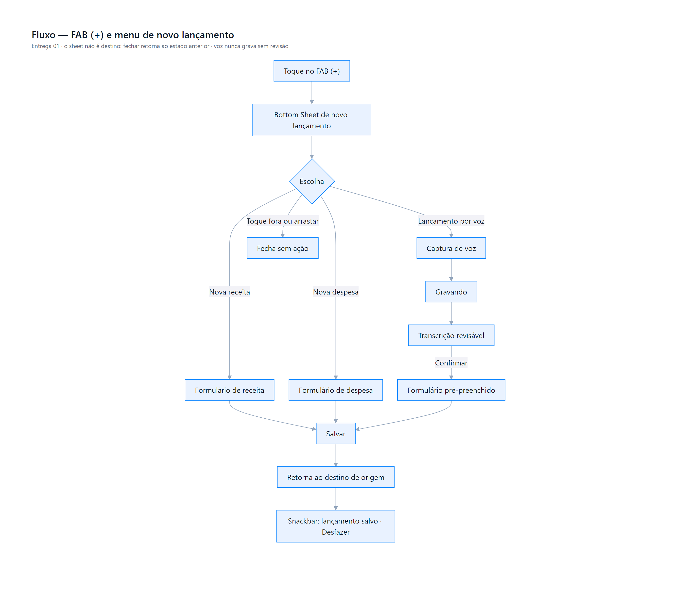
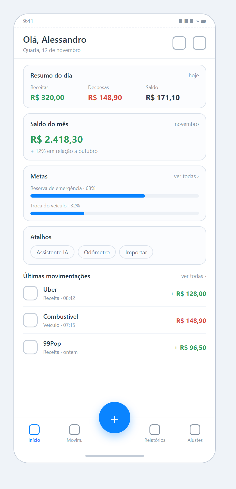
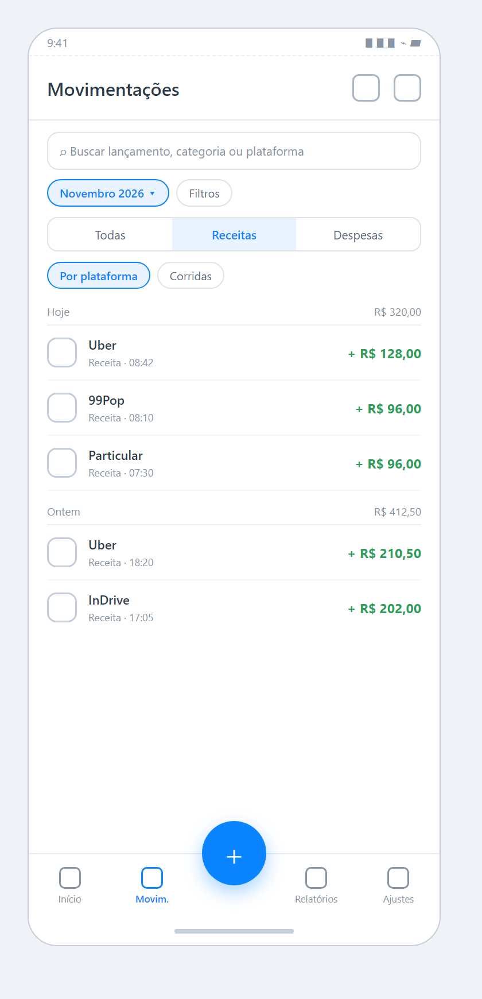
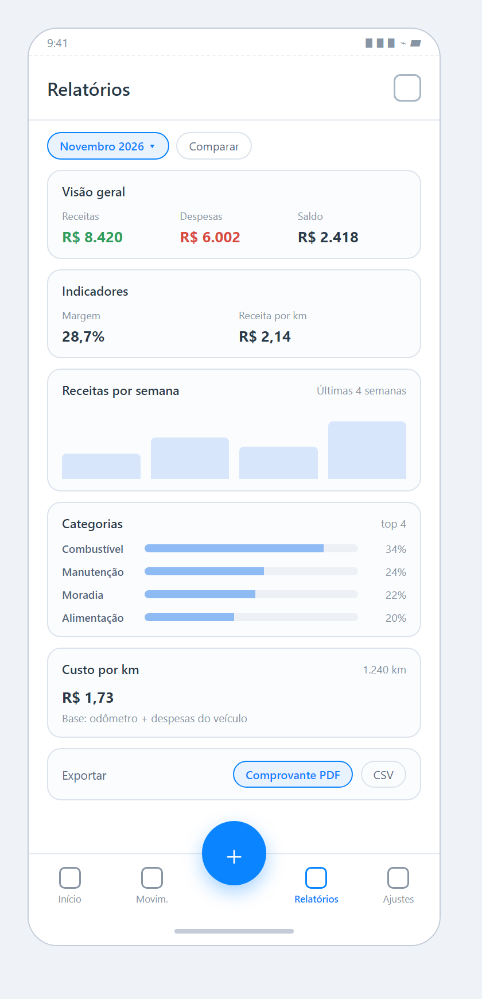
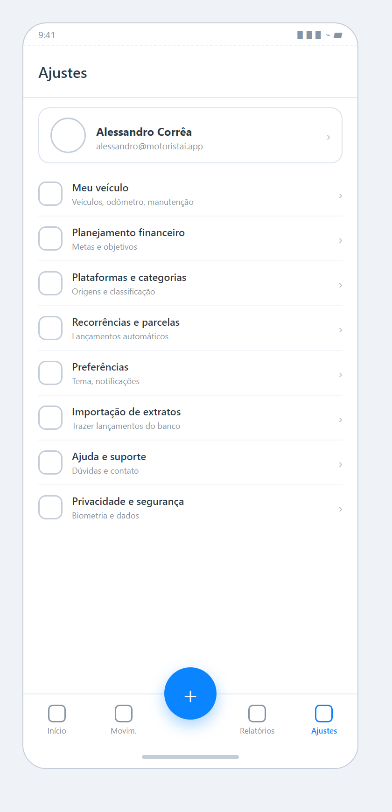
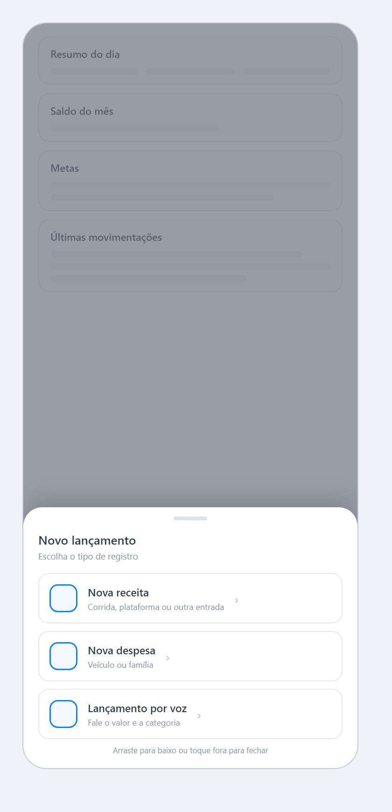
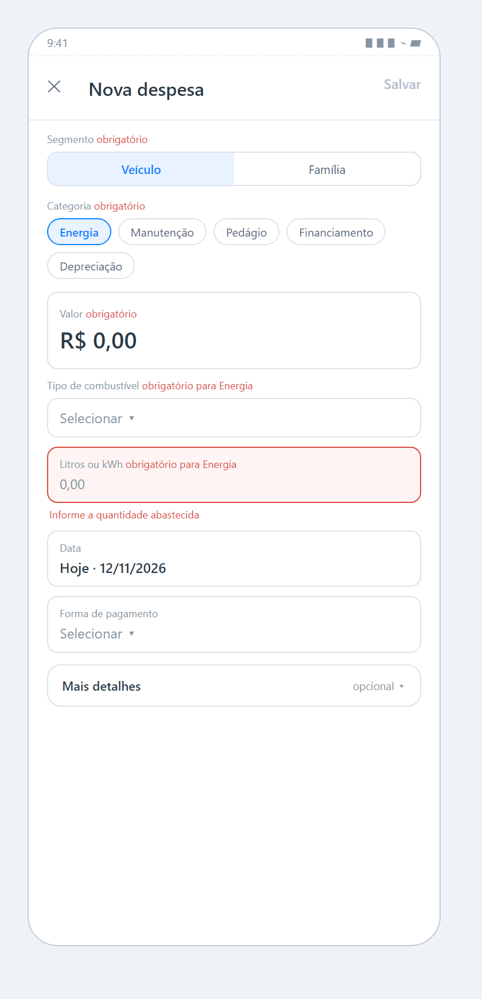
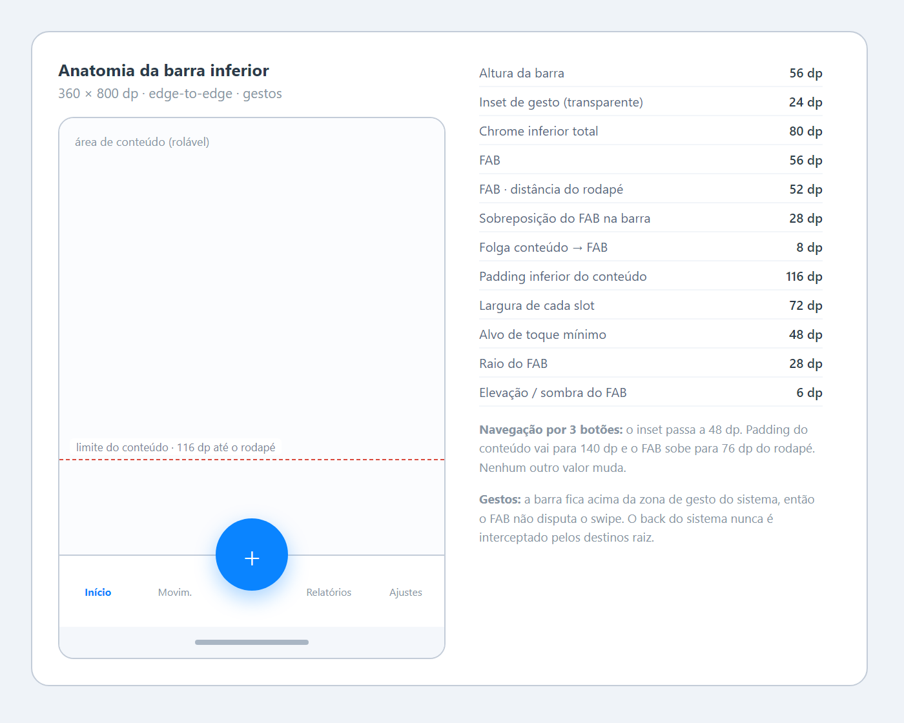

# MotoristAI — Entrega 01: Arquitetura e Navegação

**Fase:** UX/UI Android nativo · **Etapa:** arquitetura (sem alta fidelidade)
**Data:** 2026-11-12 · **Status:** arquitetura aprovada com ajustes · revisão 02 aguardando validação final

---

## Arquivos desta entrega

| Arquivo | Conteúdo |
|:--|:--|
| `01-mapa-navegacao.png` | Mapa completo de navegação (todos os destinos e telas secundárias) |
| `02-fluxo-fab.png` | Fluxo do botão central (+) e menu de novo lançamento |
| `03-fluxo-nova-despesa.png` | Fluxo de nova despesa com preenchimento progressivo |
| `matriz-preservacao.csv` | Matriz de preservação das funcionalidades existentes |
| `mapa.html`, `fluxo-fab.html`, `fluxo-despesa.html` | Fontes editáveis dos diagramas |
| `wireframes/01` a `wireframes/06` | Seis wireframes de baixa fidelidade |
| `wireframes/07-anatomia-barra.png` | Anatomia da barra inferior com FAB central |
| `wireframes.html` | Fonte editável dos sete wireframes |
| `especificacao-formularios.md` | Obrigatoriedade por categoria e regra do Desfazer |

O documento abaixo consolida os três entregáveis pedidos: mapa, fluxos e matriz.

---

## 1. Estrutura de navegação

Quatro destinos fixos na barra inferior, persistentes, mais uma ação global destacada.

| Posição | Destino | Responsabilidade |
|:--|:--|:--|
| 1 | **Início** | Resumo do dia, saldo, metas, últimas movimentações, atalhos |
| 2 | **Movimentações** | Histórico unificado, filtros, pesquisa, detalhe |
| 3 | **Relatórios** | Análises, indicadores, gráficos, custo por km, exportações |
| 4 | **Ajustes** | Configurações e cadastros em oito grupos |
| — | **FAB (+)** | Nova receita · Nova despesa · Lançamento por voz |

### Regras estruturais

- A barra inferior é **persistente** nos quatro destinos e **não existe** em telas secundárias
  (nelas, a barra é substituída por TopAppBar com seta de retorno).
- Existe **um único** botão de ação global: o FAB. O microfone não aparece como botão flutuante
  em nenhuma tela — ele é uma opção dentro do FAB.
- Nenhum destino duplica atalho de outro. Uma tela pode ser alcançada por mais de um caminho
  (Metas: Início e Ajustes), mas é sempre a **mesma tela**, nunca uma cópia.
- Os quatro destinos preservam o próprio estado (scroll, filtro, aba) ao alternar entre si.

### Níveis de profundidade

| Nível | O que é | Chrome de navegação |
|:--|:--|:--|
| 0 | Entrada: splash, login, biometria, Google, onboarding, recuperação de senha | Sem barra |
| 1 | Os quatro destinos | Barra inferior + FAB |
| 2 | Telas secundárias: detalhe, formulários, listas de cadastro | TopAppBar com retorno |
| 3 | Bottom sheets, confirmações, filtros, anexos | Sheet sobre a tela |
| 4 | Tela cheia temporária: Assistente IA, captura de voz, notificações | X ou concluir |

---

## 2. Mapa completo de navegação

---

## 3. Fluxos de navegação

### 3.1 FAB (+) e menu de novo lançamento

- O Bottom Sheet **não é destino**: fechar retorna ao estado exato anterior.
- Após salvar, o usuário volta ao destino de origem (não é jogado para Movimentações),
  com confirmação por snackbar e ação *Desfazer*.
- Voz **nunca** grava direto: a transcrição sempre passa por um formulário pré-preenchido.
- Formulário com alterações pendentes pede confirmação de descarte ao voltar.

### 3.2 Nova despesa com preenchimento progressivo

- Tela **única**, com três níveis de profundidade — não é um wizard de etapas.
- **Nível 1 (essencial):** segmento, categoria, valor. Salvar já fica habilitado aqui.
- **Nível 2 (contexto):** data (hoje por padrão) e forma de pagamento.
- **Nível 3 (opcional, expandido sob demanda):** odômetro/km, litros ou kWh, parcela ou
  recorrência, plataforma, observação e anexo de foto.
- Os campos dos níveis 2 e 3 mudam conforme a categoria escolhida.

### 3.3 Retorno de navegação

| Origem → destino | Retorno | Preserva estado |
|:--|:--|:--|
| Destino → tela secundária | TopAppBar com seta + gesto de voltar | Sim |
| Formulário sem alterações | Seta, gesto ou back do sistema sai direto | — |
| Formulário com alterações | Back pede confirmação de descarte | — |
| Bottom Sheet | Arrastar para baixo, toque no scrim ou back | Sim |
| Captura de voz | X cancela e volta ao sheet | — |
| Assistente IA | X ou seta de volta para o Início | Conversa preservada na sessão |
| Central de notificações | Seta de volta | Marcações de lido preservadas |
| Ajustes: grupo → sub-tela | Seta de volta | — |

---

## 4. Estrutura dos destinos

### 4.1 Início

Ordem vertical, rolável, em faixas de conteúdo — sem grade de cartões.

1. Cabeçalho: saudação, nome, **sino de notificações** com badge, atalho de tema.
2. **Resumo do dia:** receitas, despesas e saldo do dia.
3. **Bloco de saldo** do período, com indicador positivo ou negativo.
4. **Metas:** uma ou duas em progresso, com barra e percentual; toque abre Metas.
5. **Atalhos rápidos:** Assistente IA, registrar odômetro, importar extrato (máximo três).
6. **Últimas movimentações:** cinco itens em lista; "ver todas" leva ao destino 2.

### 4.2 Movimentações

- Topo: pesquisa e botão de período (chip com o período ativo).
- Segmentação primária: `Todas · Receitas · Despesas`.
- Segmentação secundária condicional:
  - Receitas: lentes `Por plataforma` e `Corridas`.
  - Despesas: segmentos `Veículo` e `Família`.
- Lista agrupada por data, com cabeçalho de dia e subtotal.
- Item: título, categoria ou plataforma, valor em verde ou vermelho, hora.
- Detalhe do lançamento: dados completos, anexos e ações Editar, Duplicar, Anexar foto, Excluir.

### 4.3 Relatórios

- Seletor de período fixo no topo (mês atual por padrão), aplicado a todos os blocos.
- Blocos: visão geral e indicadores, gráficos e categorias, custo por quilômetro,
  custos com energia, resumo mensal.
- Exportação: comprovante de renda (PDF) e CSV.
- Cada bloco tem estado vazio próprio. Exemplo: custo por km sem odômetro registrado
  exibe um direcionamento para Ajustes › Meu veículo › Registros de odômetro.

### 4.4 Ajustes

Lista de grupos, um por seção, com subtítulo de uma linha.

| Grupo | Subtítulo | Sub-telas |
|:--|:--|:--|
| Meu veículo | Veículos, odômetro, manutenção | Veículos · Registros de odômetro · Alertas de manutenção · Financiamento e depreciação |
| Planejamento financeiro | Metas e objetivos | Metas |
| Plataformas e categorias | Origens e classificação | Plataformas · Categorias |
| Recorrências e parcelas | Lançamentos automáticos | Recorrências · Lembretes de despesas |
| Preferências | Tema, notificações | Tema · Notificações |
| Importação de extratos | Trazer lançamentos do banco | Importar extrato |
| Ajuda e suporte | Dúvidas e contato | FAQ · Suporte |
| Privacidade e segurança | Biometria e dados | Biometria · Políticas, Termos e LGPD |

---

## 5. Matriz de preservação das funcionalidades

Versão completa e filtrável em [`matriz-preservacao.csv`](matriz-preservacao.csv).

**Forma:** `TELA` = continua sendo tela própria · `ABSORVIDA` = deixa de ser tela isolada
e passa a ser parte de um fluxo ou passo de formulário.

### 5.1 Entrada e transversais

| Tela atual | Novo destino | Forma |
|:--|:--|:--|
| Login (e-mail e senha) | Nível 0 · Login | TELA |
| Login biométrico | Nível 0 · Login | TELA |
| Login Google | Nível 0 · Login | TELA |
| Recuperação de senha | Nível 0 · Login | TELA |
| Onboarding | Nível 0 · após primeiro login | TELA |
| Logout por inatividade e sessão de 24 h | Transversal — regra atual mantida | ABSORVIDA |
| Alternância de tema | Ajustes › Preferências + atalho no Início | TELA |

### 5.2 Destino 1 — Início

| Tela atual | Novo destino | Forma |
|:--|:--|:--|
| Dashboard | Início | TELA |
| Card de metas do Dashboard | Início › bloco Metas | ABSORVIDA |
| Metas (gestão) | Início › Metas | TELA |
| Assistente IA | Início › Assistente IA | TELA |
| Últimas movimentações | Início › bloco + destino 2 | ABSORVIDA |
| Central de alertas | Início › sino › Notificações | TELA |

### 5.3 Destino 2 — Movimentações

| Tela atual | Novo destino | Forma |
|:--|:--|:--|
| Entradas / Receitas | Movimentações › Receitas | TELA |
| Corridas | Movimentações › Receitas › Corridas | TELA |
| Nova receita | FAB › Nova receita | TELA |
| Editar receita | Detalhe › Editar | TELA |
| Despesas | Movimentações › Despesas | TELA |
| Despesas do veículo (lista) | Despesas › segmento Veículo | TELA |
| Despesas da família (lista) | Despesas › segmento Família | TELA |
| Escolha de tipo de despesa | FAB › Nova despesa › seletor inline | ABSORVIDA |
| Energia e combustível | Formulário de despesa, campos condicionais | ABSORVIDA |
| Manutenção | Formulário de despesa, campos condicionais | ABSORVIDA |
| Pedágio e estacionamento | Formulário de despesa, campos condicionais | ABSORVIDA |
| Financiamento do veículo | Formulário de despesa, campos condicionais | ABSORVIDA |
| Depreciação | Formulário de despesa, campos condicionais | ABSORVIDA |
| Moradia, Alimentação, Saúde, Educação, Lazer, Outras | Formulário de despesa, campos condicionais | ABSORVIDA |

### 5.4 Destino 3 — Relatórios

| Tela atual | Novo destino | Forma |
|:--|:--|:--|
| Relatórios | Relatórios | TELA |
| Insights | Relatórios › seções de análise | ABSORVIDA |
| Comprovante de renda (PDF) | Relatórios › Exportar | TELA |
| Custo por km | Relatórios › bloco Custo por km | ABSORVIDA |
| Custos com energia | Relatórios › bloco Energia | ABSORVIDA |
| Exportação CSV | Relatórios › Exportar | ABSORVIDA |
| Lista de depreciação | Ajustes › Meu veículo › Depreciação | TELA |
| Lista de financiamento | Ajustes › Meu veículo › Financiamento | TELA |

### 5.5 Destino 4 — Ajustes

| Tela atual | Novo destino | Forma |
|:--|:--|:--|
| Ajustes | Ajustes | TELA |
| Veículos | Ajustes › Meu veículo | TELA |
| Odômetro | Ajustes › Meu veículo › Registros de odômetro | TELA |
| Alertas de manutenção | Ajustes › Meu veículo | TELA |
| Metas | Ajustes › Planejamento financeiro | TELA |
| Lembretes de despesas | Ajustes › Recorrências e parcelas | TELA |
| Plataformas e Categorias | Ajustes › Plataformas e categorias | TELA |
| Recorrências | Ajustes › Recorrências e parcelas | TELA |
| Preferências | Ajustes › Preferências | TELA |
| Importar extrato | Ajustes › Importação de extratos | TELA |
| FAQ | Ajustes › Ajuda e suporte | TELA |
| Suporte | Ajustes › Ajuda e suporte | TELA |
| Biometria | Ajustes › Privacidade e segurança | TELA |
| Políticas, Termos e LGPD | Ajustes › Privacidade e segurança | TELA |
| Nota por foto | Anexo dentro de qualquer lançamento | ABSORVIDA |

> Duas telas deixam de existir como destino navegável — **Odômetro** e **Nota por foto** —
> sem perder funcionalidade: odômetro vira registro do veículo que alimenta o custo por km;
> nota por foto vira anexo do lançamento.

---

## 6. Design system — base para a etapa visual

Duas versões equivalentes: mesma estrutura de componentes, mesmas dimensões, mesmo
comportamento. A identidade azul vem da paleta atual do app.

> [!IMPORTANT]
> **Os tokens de cor abaixo foram substituídos.** O documento canônico agora é
> [`docs/ux/entrega-02/tokens.md`](../entrega-02/tokens.md), derivado das pranchas oficiais
> de White e Dark Mode. A tabela que existia aqui (paleta iOS, superfície dark `#1C2B3A`,
> borda em alfa) está revogada — mantê-la criaria duas verdades no repositório.
>
> Resumo do que mudou: superfície dark passa a `#112630`, borda dark a `#1E3A5F`, fundo light
> a `#F1F5F9`, e todo par texto/fundo passa a ter contraste medido.

**Regras**

- Nenhum componente usa cor fixa: tudo consome token semântico.
- Verde e vermelho ficam reservados a valores financeiros e estados, nunca como decoração.
- Contraste mínimo AA em texto sobre `surface` e `primary`, nos dois modos.
- Elevação: dark mode usa variação de superfície; white mode usa borda sutil e sombra mínima.
- O mapa para Material 3 (`primary`, `surface`, `surfaceContainer`) é trabalho da etapa de
  alta fidelidade.

---

## 7. Wireframes de baixa fidelidade

Todos em 360 × 800 dp, com barra de status, barra inferior e inset de gesto desenhados.

### 7.1 Início

Faixas de conteúdo empilhadas, sem grade de cartões. FAB sobreposto à barra, conteúdo
encerrando 116 dp acima do rodapé.

### 7.2 Movimentações

Pesquisa, período, segmentação primária (Todas / Receitas / Despesas) e lente secundária
(Por plataforma / Corridas). Lista agrupada por dia com subtotal.

### 7.3 Relatórios

Período fixo no topo aplicado a todos os blocos, incluindo a área de exportação
(comprovante de renda em PDF e CSV) ao final.

### 7.4 Ajustes

Perfil no topo e oito grupos em lista, cada um com subtítulo de uma linha e chevron.

### 7.5 Bottom Sheet (+)

Sheet modal sobre o destino atual. O scrim cobre inclusive a barra inferior — a barra
e o FAB ficam inoperantes enquanto o sheet estiver aberto.

### 7.6 Nova despesa

Tela secundária: sem barra inferior e sem FAB, apenas TopAppBar com ✕ e Salvar.
Exibe o caso de erro em campo obrigatório da categoria selecionada.

---

## 8. Barra inferior, FAB e área segura

| Medida | Valor |
|:--|:--|
| Altura da barra | 56 dp |
| Inset de gesto (transparente) | 24 dp |
| Chrome inferior total | 80 dp |
| FAB | 56 dp, raio 28 dp, elevação 6 dp |
| Distância do FAB ao rodapé | 52 dp |
| Sobreposição do FAB na barra | 28 dp |
| Padding inferior do conteúdo | 116 dp |
| Largura de cada slot | 72 dp (5 slots em 360 dp) |
| Alvo de toque mínimo | 48 dp |

**Regras**

- Edge-to-edge: a barra desenha o próprio fundo e consome o inset de gesto abaixo dela,
  em vez de deixar o sistema pintar uma faixa.
- O FAB fica 28 dp acima da barra e 52 dp do rodapé, portanto fora da zona de gesto do
  sistema — o swipe de navegação não disputa o botão.
- O conteúdo recebe 116 dp de padding inferior para que o último item nunca fique sob o FAB.
- Em navegação por 3 botões o inset passa a 48 dp: o padding do conteúdo vai a 140 dp e o
  FAB sobe para 76 dp do rodapé. Nenhum outro valor muda.
- O back do sistema não é interceptado nos quatro destinos raiz; sai do app.
- O FAB e a barra ficam inoperantes sob qualquer sheet modal.

---

## 9. Validação de formulários

Especificação completa em [`especificacao-formularios.md`](especificacao-formularios.md).

Resumo:

- **Comuns obrigatórios:** segmento, categoria e valor.
- **Obrigatório por categoria é sempre visível** — nunca atrás de "Mais detalhes".
  Exemplos: Energia exige tipo de combustível e litros ou kWh; Financiamento exige número
  da parcela; Outras exige descrição.
- **Recomendado ≠ obrigatório.** Odômetro em Energia e distância em Corrida avisam, mas não
  bloqueiam; Relatórios declara a cobertura quando o dado falta.
- **Erro no blur e ao salvar**, nunca a cada tecla. Salvar rola até o primeiro erro.
- **Odômetro não retrocede**: até 5% de folga pede confirmação, acima disso bloqueia.

---

## 10. Desfazer após salvar

Especificação completa em [`especificacao-formularios.md`](especificacao-formularios.md#5-ação-desfazer).

| Ação | Desfazer | Janela |
|:--|:--|:--|
| Criar lançamento | Sim | 5 s |
| Editar lançamento | Sim | 5 s |
| Excluir lançamento | Sim | 5 s |
| Importar extrato em lote | Sim | 5 s |
| Exportar PDF ou CSV | Não | — |
| Excluir veículo ou conta | Não — confirmação destrutiva | — |
| Alterar tema ou preferências | Não — reversível no próprio controle | — |

- Um Desfazer por vez; um novo snackbar substitui o anterior.
- Trocar de tela ou de destino encerra a janela de 5 s.
- Desfazer de exclusão restaura o registro com o mesmo id e os mesmos vínculos.
- Desfazer não reverte efeitos externos (notificação, e-mail, link aberto).

---

## 11. Pendências para validação

| # | Ponto | Situação |
|:--|:--|:--|
| 1 | Receitas tem duas fontes de dados no app atual: `entradas` (agregada por plataforma) e `corridas` (individual, com distância). Tratado como duas lentes da mesma aba, sem fundir os dados. | Confirmar |
| 2 | Odômetro e Nota por foto deixam de ser destinos de navegação. | Confirmar |
| 3 | Central de notificações como tela própria (não sheet), acessada pelo sino no Início. | Confirmar |
| 4 | Assistente IA em tela cheia coberta, sem barra inferior, com X de retorno. | Confirmar |
| 5 | Lente Corridas dentro de Receitas: sub-aba ou chip de filtro. | Confirmar |

> A aprovação da arquitetura não respondeu a estes cinco pontos. Todos seguem
> implementados conforme especificado acima; alterações aqui afetam apenas navegação,
> não o restante da entrega.

---

## 12. Revisão 02 — ajustes atendidos

| # | Ajuste solicitado | Onde foi atendido |
|:--|:--|:--|
| 1 | Validação com obrigatórios por categoria | [`especificacao-formularios.md`](especificacao-formularios.md) seção 3 |
| 2 | Quando o Desfazer fica disponível | [`especificacao-formularios.md`](especificacao-formularios.md#5-ação-desfazer) seção 5 |
| 3 | Seis wireframes de baixa fidelidade | `wireframes/01` a `wireframes/06` |
| 4 | Barra inferior com FAB e área segura | `wireframes/07-anatomia-barra.png` e seção 8 |

Código funcional permanece inalterado — esta revisão é apenas documental.

---

## Próximo passo

Arquitetura e wireframes de baixa fidelidade entregues. Aguardando validação final para
iniciar a etapa de alta fidelidade (design visual nas duas versões de tema) e, somente
depois dela, a migração para Kotlin + Jetpack Compose.
