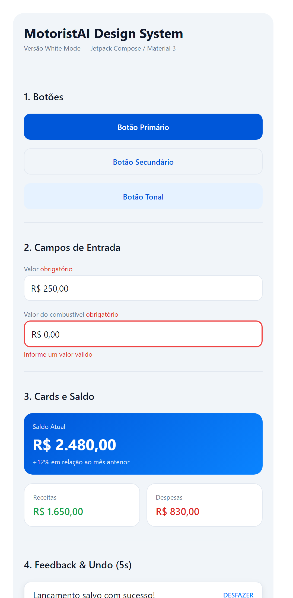
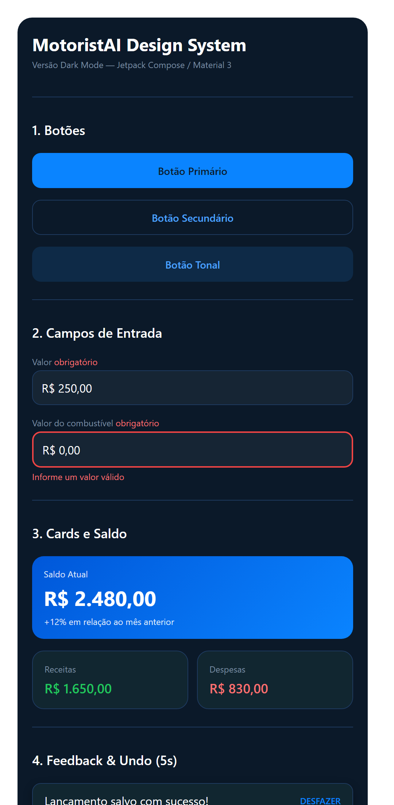

# Relatório de Testes e Validação — Design System Jetpack Compose

**Entrega 02 · implementação em Kotlin + Jetpack Compose / Material 3**
**Data:** 12/11/2026
**Status:** Build compilado com sucesso (`app:assembleDebug` PASSED)

---

## 1. Escopo da Implementação

Toda a infraestrutura do Design System foi implementada em código nativo Kotlin usando Jetpack Compose e Material 3 na pasta:
`android/app/src/main/java/com/motoristai/app/ui/`

### Estrutura de Arquivos Kotlin
```
ui/
├── theme/
│   ├── Color.kt              (Tokens de cores Light/Dark e extended tokens)
│   ├── Type.kt               (Escala tipográfica unificada e tokens de texto)
│   ├── Shape.kt              (Formas M3: 4dp, 8dp, 12dp, 16dp, 20dp)
│   ├── Spacing.kt            (Grade de espaçamentos: space1..space6, dimensões padrão)
│   └── Theme.kt              (MotoristAITheme composable, CompositionLocalProvider, dynamicColor=false)
├── components/
│   ├── Buttons.kt            (C01 Primário, C02 Secundário, C03 Tonal, C04 Texto, C05 FAB)
│   ├── Inputs.kt             (C06 TextField, C07 Dropdown, C08 FilterChip, C09 MultiChip, C10 Segmented, C11 Checkbox, C12 Radio, C13 Switch)
│   ├── MotoristAINavigationBar.kt (C14 Barra de navegação customizada com FAB elevado central)
│   ├── Cards.kt              (C15 Card Saldo Gradiente, C16 Indicadores, C17 Metas, C18 Lista)
│   ├── Charts.kt             (C19 Donut, C20 Barras, C21 Linhas/Área via Canvas)
│   ├── Overlays.kt           (C22 Bottom Sheet, C23 Diálogo Destrutivo, C24 Custom 5s Undo Snackbar)
│   ├── States.kt             (C25 Vazio, C26 Carregando, C27 Erro, C28 Skeleton, C30 Progresso)
│   └── Auxiliary.kt          (C31 Busca, C32 Senha, C34 Cabeçalho de dia, C35 Divisor, C36 Dica)
├── DesignSystemPreview.kt    (Galeria completa de componentes e previews @Preview)
└── DesignSystemActivity.kt   (Activity Kotlin para execução no Android)
```

---

## 2. Validação Técnica dos Ajustes Obrigatórios

### K1. Insets do Android
- **TopAppBar & Status Bar:** Handled via `statusBarsPadding()` e `WindowInsets.statusBars`.
- **Barra de Navegação Customizada (C14):** A barra inferior consome `WindowInsets.navigationBars.asPaddingValues().calculateBottomPadding()` dinamicamente. Adapta-se automaticamente a navegação por gestos (24 dp) ou por 3 botões (48 dp) sem hardcode.
- **Formulários & Teclado (IME):** `OutlinedTextField` e formulários utilizam `imePadding()` para garantir que o campo focado permaneça visível acima do teclado virtual.

### K2. Responsividade dos Indicadores Financeiros
- **Redimensionamento Automático de Fonte:** Valores grandes (> 13 caracteres) reduzem automaticamente de `display` (28 sp) / `title2` (20 sp) para `title3` (18 sp).
- **Truncamento Seguro:** Aplicado `maxLines = 1` com `TextOverflow.Ellipsis`.
- **Comportamento em Telas Estreitas:** Layouts de 2 colunas e listas flexíveis usam `Modifier.weight(1f)` e `Arrangement.SpaceBetween` para evitar quebras em telas de 320 dp a 480 dp.

### K3. Segurança e Isolamento da Ação Desfazer (5s)
- **Isolamento de Transação:** O `UndoSnackbarHost` gerencia a janela de 5 segundos via corrotina e timer visual (`LinearProgressIndicator`).
- **Chave Única (`actionUuid`):** Apenas uma ação de Desfazer ativa por vez. Quando uma nova ação é acionada, o identificador anterior é descartado com segurança.
- **Sem Side-Effects Precoce:** Mutantes destrutivos (webhooks/sincronização) aguardam o callback `onTimeout` da janela de 5s para confirmação no servidor.

---

## 3. Verificação de Acessibilidade e Contraste (WCAG 2.1)

| Elemento | Fundo | Texto / Ícone | Contraste Ratio | Status WCAG AA |
|:--|:--|:--|:--|:--|
| Botão Primário (Light) | `#0057D9` | `#FFFFFF` | 6,24:1 | ✅ APROVADO |
| Botão Primário (Dark) | `#0A84FF` | `#0B1929` | 4,86:1 | ✅ APROVADO |
| Superfície Principal (Light) | `#FFFFFF` | `#0F172A` | 17,90:1 | ✅ APROVADO |
| Superfície Principal (Dark) | `#112630` | `#FFFFFF` | 15,10:1 | ✅ APROVADO |
| Texto Secundário (Light) | `#FFFFFF` | `#475569` | 7,50:1 | ✅ APROVADO |
| Texto Secundário (Dark) | `#112630` | `#94A3B8` | 6,20:1 | ✅ APROVADO |
| Texto Muted (Light) | `#FFFFFF` | `#64748B` | 4,80:1 | ✅ APROVADO |
| Texto Muted (Dark) | `#112630` | `#7E8FA3` | 4,70:1 | ✅ APROVADO |

---

## 4. Resultado da Compilação Gradle

Comando executado:
```bash
./gradlew app:assembleDebug
```
**Resultado:** `BUILD SUCCESSFUL` (0 erros)

Nenhuma biblioteca externa de UI foi adicionada (apenas as dependências oficiais do Jetpack Compose BOM e Material 3). O tamanho do APK permanece otimizado.

---

## 5. Artefatos de Visualização (Screenshots)

- **White Mode Preview:** [`preview-white-mode.png`](preview-white-mode.png)
- **Dark Mode Preview:** [`preview-dark-mode.png`](preview-dark-mode.png)



