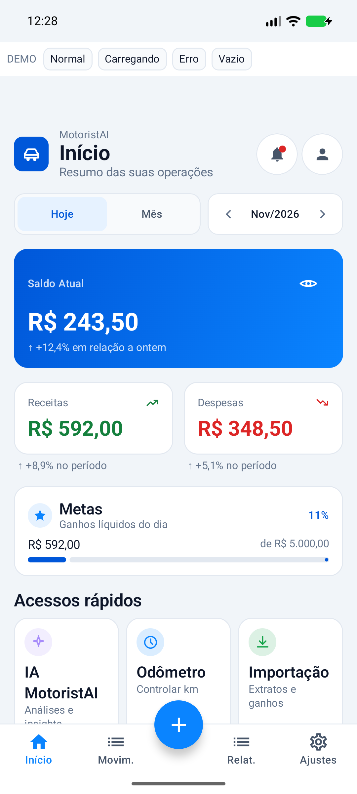
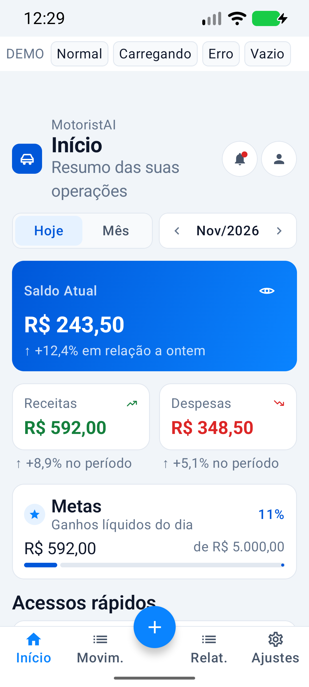

# Demo nativa da Home — como executar

Activity de demonstração: `com.motoristai.app.ui.demo.DemoHomeActivity`

> [!IMPORTANT]
> Esta Activity **não** é a entrada do aplicativo. Ela não declara `MAIN/LAUNCHER`,
> a `MainActivity` e o WebView de produção continuam intactos.

## 1. Pelo Android Studio

1. Abra o projeto `android/` no Android Studio e aguarde o Gradle Sync.
2. Crie uma Run Configuration em **Run › Edit Configurations… › + › Android App**:
   * **Name:** `MotoristAI Demo Home`
   * **Module:** `app`
   * **Launch options:** `Specific Activity`
   * **Activity:** `com.motoristai.app.ui.demo.DemoHomeActivity`
3. Selecione o dispositivo/emulador e clique em **Run**.

Há também uma configuração pronta em `.run/MotoristAI Demo Home.run.xml`. Se o
Android Studio não resolver o nome do módulo, selecione `app` no campo **Module**
da configuração — o restante já está preenchido.

## 2. Por linha de comando

```bash
cd android
./gradlew app:installDebug
adb shell am start -n com.motoristai.app/com.motoristai.app.ui.demo.DemoHomeActivity
```

## 3. Barra de controle da demonstração

No topo da tela existe uma barra exclusiva do harness de demonstração:

| Chip | Efeito |
|:--|:--|
| `Normal` | Estado normal, com as movimentações fictícias |
| `Carregando` | `isLoading = true` → `LoadingState` |
| `Erro` | `hasError = true` → `ErrorState` com **Tentar novamente** |
| `Vazio` | lista vazia → `EmptyState` |

## 4. O que é funcional na demonstração

| Elemento | Comportamento |
|:--|:--|
| `Hoje` / `Mês` | troca o período e recalcula os valores fictícios |
| `‹ Nov/2026 ›` | navega entre meses (valores variam 7% por mês) |
| ícone do olho | oculta/expõe o saldo |
| App bar (sino / perfil) | snackbar de indisponibilidade |
| IA MotoristAI / Odômetro / Importação | snackbar de indisponibilidade |
| item de movimentação | snackbar informando o id selecionado |
| `Ver todas >` | snackbar informando que a lista completa virá depois |
| FAB `+` | abre o bottom sheet **Novo lançamento** |
| Nova receita / Nova despesa / Lançamento por voz | fecha o sheet + snackbar; **nada é gravado** |
| barra inferior | alterna entre Início e os placeholders dos demais destinos |

> [!WARNING]
> Não há banco de dados, rede, autenticação nem regra financeira nesta demonstração.
> Todos os valores são fictícios e vivem em `DemoHomeState`.

## 5. Executar os testes instrumentados

```bash
cd android
./gradlew app:connectedDebugAndroidTest \
  -Pandroid.testInstrumentationRunnerArguments.class=com.motoristai.app.ui.demo.DemoHomeUiTest
```

`ExampleInstrumentedTest` (template do Capacitor) **não** pertence a esta entrega e
está quebrado no repositório: ele espera o pacote `com.getcapacitor.app`, mas o
`applicationId` é `com.motoristai.app`. Por isso a suíte completa
(`connectedDebugAndroidTest` sem filtro) falha. Rodar a classe `DemoHomeUiTest`
isola corretamente os testes desta entrega.

## 6. Evidências capturadas

Todas em `docs/ux/entrega-03/`, capturadas em emulador (`emulator-5554`,
Android 37, 1080×2400). Os links abaixo são relativos e funcionam no GitHub.

| Cenário | Arquivo |
|:--|:--|
| White Mode, largura nativa (411 dp) | [emulador-light-411dp.png](emulador-light-411dp.png) |
| Dark Mode, largura nativa (411 dp) | [emulador-dark-411dp.png](emulador-dark-411dp.png) |
| Dark Mode, 320 dp | [emulador-dark-320dp.png](emulador-dark-320dp.png) |
| Dark Mode, 360 dp | [emulador-dark-360dp.png](emulador-dark-360dp.png) |
| White Mode, 480 dp | [emulador-light-480dp.png](emulador-light-480dp.png) |
| Fonte 150 % | [emulador-light-font150.png](emulador-light-font150.png) |
| Fonte 200 % | [emulador-light-font200.png](emulador-light-font200.png) |

### White Mode — 411 dp



### Dark Mode — 411 dp


### Dark Mode — 320 dp


### Dark Mode — 360 dp


### White Mode — 480 dp


### Escala de fonte 150 %



### Escala de fonte 200 %


