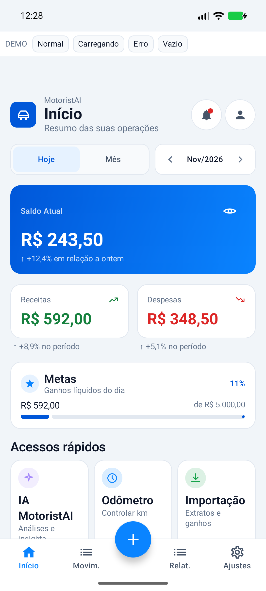
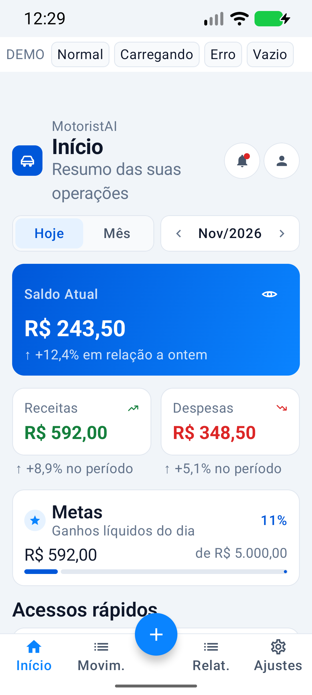

# Relatório — Entrega 03.2 (Home nativa executada no emulador)

**Referência anterior:** commit `1778abd` (Entrega 03.1.3)
**Escopo:** ponto de entrada demonstrativo, controlador de estado, FAB + bottom sheet,
navegação inferior, testes instrumentados e execução real em emulador Android.
**Data:** 13/11/2026

---

## 1. Ambiente de execução

| Item | Valor |
|:--|:--|
| Emulador | `emulator-5554` · AVD `motoristai_demo` (criado a partir do perfil Pixel 6) |
| Android | 37 (API 37), x86_64, WHPX |
| Resolução | 1080 × 2400 @ 420 dpi → **411 dp** de largura nativa |
| JDK / Gradle | 21 · Gradle 9.6 · AGP 9.4.1 · Kotlin 2.2.10 |
| Data/Hora | 13/11/2026, ~11:40–11:57 |

> [!NOTE]
> O AVD original em `C:` não subia: o disco tinha **1,91 GB livres** e o emulador
> aborta com `Your device does not have enough disk space`. O AVD desta entrega foi
> criado em `Z:\android-avd` (`ANDROID_AVD_HOME`), sem alterar nenhum AVD existente
> do usuário.

---

## 2. O que foi implementado

| Arquivo | Papel |
|:--|:--|
| `ui/demo/DemoHomeActivity.kt` | Activity de demonstração (`explicit activity`, sem `MAIN/LAUNCHER`), `enableEdgeToEdge` + tema do sistema |
| `ui/demo/DemoHomeState.kt` | Estado fictício: período, mês, saldo visível, loading/erro/vazio, sheet, destino, mensagens |
| `ui/demo/DemoHomeContent.kt` | Harness: barra de controle da demo, `HomeScreen`, `SnackbarHost`, `MotoristAINavigationBar` no fluxo e `ModalBottomSheet` |
| `ui/screens/HomeScreen.kt` | Correções de layout descritas na seção 3 |
| `ui/navigation/NavigationMetrics.kt` | Limiar de rótulo curto 68 → 92 dp |
| `app/build.gradle` | `ui-test-junit4`, `ui-test-manifest`, runner/rules |
| `app/src/androidTest/.../DemoHomeUiTest.kt` | 14 testes instrumentados |

A `MainActivity` e o WebView de produção **não** foram tocados.

---

## 3. Defeitos encontrados executando de verdade (e corrigidos)

Todos abaixo só apareceram ao rodar no emulador — nenhum era detectável só lendo o código.

| # | Sintoma | Causa raiz | Correção |
|--:|:--|:--|:--|
| 1 | Navegador de mês saía da tela, "Mês" cortado | `Row` do seletor sem `weight`: as abas com `weight(1f)` ocupavam toda a largura | `PeriodTabs(weight(1f))` + `MonthNavigator` com largura intrínseca; empilha abaixo de 300 dp ou acima de 150 % de fonte |
| 2 | Sino e perfil cortados na borda direita | `Row` do título sem `weight`, empurrando as ações para fora | `Row(Modifier.weight(1f))` no bloco de título |
| 3 | "Ver todas >" ficava **atrás** da barra inferior e não recebia toque | Barra desenhada como overlay opaco sobre o conteúdo rolável | Barra inferior movida para o **fluxo** do `Column` — o conteúdo nunca passa por baixo dela |
| 4 | Rótulo "Movimentações" truncado a 320/360/393 dp | `SHORT_LABEL_THRESHOLD_DP = 68` dp, mas o texto em `label` (12 sp) exige ~92 dp | Limiar elevado para 92 dp (só 480 dp usa o rótulo completo) |
| 5 | Crash `IllegalStateException: Asking for intrinsic measurements of SubcomposeLayout` no teste de erro | `Row(Modifier.height(IntrinsicSize.Min))` medindo `MoneyText`, que usa `BoxWithConstraints` | Removido o `IntrinsicSize.Min` da linha de indicadores |
| 6 | Snackbar "não aparecia" nos testes | **Falso negativo**: o snackbar funcionava (confirmado por log), mas o emulador é lento e a duração curta (4 s) expirava antes da asserção | Demo passa a usar `SnackbarDuration.Long` |
| 7 | `home_renders_main_blocks` com ambiguidade em "Início" | Texto existe no cabeçalho e na barra inferior | `testTag("home_header_title")` no título do cabeçalho |

Registro honesto: os itens 1, 2, 3 e 4 são bugs de produto; 5, 6 e 7 são bugs de
teste/instrumentação.

---

## 4. Testes executados (resultados reais)

### 4.1 Compilação

```
> Task :app:assembleDebug
BUILD SUCCESSFUL
```

### 4.2 Unitários (JVM)

```
> Task :app:testDebugUnitTest
50 passed, 0 skipped, 0 failed
```

### 4.3 Instrumentados (Compose UI Test, no emulador)

```
> Task :app:connectedDebugAndroidTest \
    -Pandroid.testInstrumentationRunnerArguments.class=com.motoristai.app.ui.demo.DemoHomeUiTest
Android Test Results
 - device id: 'emulator-5554': 14 PASSED
```

Cobertura dos 14 testes:

| # | Teste | Verifica |
|--:|:--|:--|
| 1 | `home_renders_main_blocks` | cabeçalho (tag), subtítulo, acessos, movimentações |
| 2 | `period_selector_switches_between_hoje_and_mes` | clique em Hoje/Mês altera os indicadores |
| 3 | `month_navigation_changes_the_month_label` | ‹ › navegam e o rótulo muda/volta |
| 4 | `balance_visibility_toggles` | "Ocultar saldo" ⇄ "Mostrar saldo" |
| 5-7 | `quick_access_*_report_unavailability` | 3 atalhos disparam snackbar |
| 8 | `selecting_a_transaction_triggers_the_callback` | item de movimentação |
| 9 | `view_all_transactions_triggers_the_callback` | "Ver todas >" |
| 10 | `fab_opens_and_closes_the_new_entry_sheet` | FAB → sheet → opção fecha e notifica |
| 11 | `loading_state_is_displayed` | estado carregando |
| 12 | `error_state_is_displayed_and_retry_restores_content` | erro + Tentar novamente |
| 13 | `empty_state_is_displayed` | lista vazia |
| 14 | `bottom_navigation_switches_destination` | 4 destinos |

### 4.4 Impedimento registrado (fora do escopo)

`connectedDebugAndroidTest` **sem filtro** também executa
`com.getcapacitor.myapp.ExampleInstrumentedTest`, do template do Capacitor, que
espera o pacote `com.getcapacitor.app` e falha porque o `applicationId` é
`com.motoristai.app`. É uma falha pré-existente, alheia a esta entrega, e **não foi
alterada** por estar fora do escopo autorizado.

---

## 5. Validação visual (capturas reais do emulador)

Arquivos em `docs/ux/entrega-03/` (links relativos — abrem no GitHub e no navegador local).

| Cenário | Arquivo | Resultado observado |
|:--|:--|:--|
| White Mode, 411 dp | [emulador-light-411dp.png](emulador-light-411dp.png) | cabeçalho com carro, subtítulo, seletor em 1 linha, cards, metas, acessos, barra |
| Dark Mode, 411 dp | [emulador-dark-411dp.png](emulador-dark-411dp.png) | mesmos blocos, paleta escura consistente |
| Dark Mode, 320 dp | [emulador-dark-320dp.png](emulador-dark-320dp.png) | seletor empilha, sem corte de texto |
| Dark Mode, 360 dp | [emulador-dark-360dp.png](emulador-dark-360dp.png) | subtítulo quebra em 2 linhas sem truncar |
| White Mode, 480 dp | [emulador-light-480dp.png](emulador-light-480dp.png) | rótulos completos na barra inferior |
| Fonte 150 % | [emulador-light-font150.png](emulador-light-font150.png) | nada truncado |
| Fonte 200 % | [emulador-light-font200.png](emulador-light-font200.png) | seletor empilha, barra em rótulo curto, valores monetários inteiros |

### White Mode — 411 dp



### Dark Mode — 411 dp


### Dark Mode — 320 dp


### Dark Mode — 360 dp


### White Mode — 480 dp


### Escala de fonte 150 %



### Escala de fonte 200 %


> As imagens `preview-*.png` de entregas anteriores são renderizações HTML de
> tokens. As imagens `emulador-*.png` desta entrega são **capturas reais** do
> emulador (`adb exec-out screencap`).

Interações verificadas manualmente no emulador (além dos testes): troca Hoje/Mês,
navegação de mês, ocultar/mostrar saldo, abertura e seleção no bottom sheet,
snackbars (confirmados também por logcat).

---

## 6. Pendências / limitações honestas

1. **393 dp não foi capturado em imagem** — a largura existe apenas nas asserções de
   `NavigationMetricsTest`. As capturas cobrem 320, 360, 411 (nativa) e 480 dp.
2. **Barra de controle da demo em 200 %** transborda (chips "Erro"/"Vazio" saem da
   tela). É o harness de desenvolvimento, não a UI do produto — não foi corrigido
   para não gastar escopo.
3. **Navegação por 3 botões** não foi validada em imagem; o inset é tratado por
   `NavigationMetrics` e coberto por teste unitário (140 dp de padding).
4. **Nenhuma gravação de tela** foi produzida (o emulador está headless).
5. Demais telas continuam como placeholder — fora do escopo desta entrega.
